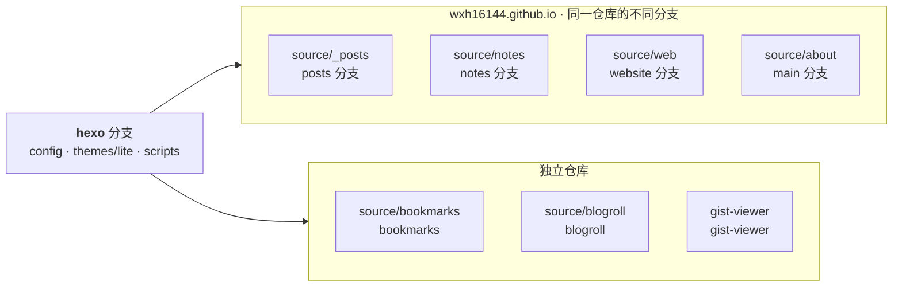

---
title: Colophon
---

这个站点由几个分支和仓库共同组成。`hexo` 分支存放配置、主题和脚本，文章和其他内容则各自维护，最后通过 git submodule 组合到一起。它们之间的关系大致如下。

> 如果你也想这样组织自己的站点，可以看看 [《用 AI 搓了一套简单的 Hexo 个人博客主题》](/rewrite-blog-theme/)。里面记录了这次重构的过程和取舍，或许能提供一些参考。

## 特性

- **AI 友好**：同一份内容既出 HTML 也出纯文本，机器不用解析页面结构就能拿到正文。
- **llms.txt**：[`/llms.txt`](/llms.txt) 是全站索引，链接一律指向 `.md` 原文。
- **Markdown 原文**：任意页面加 `.md` 就是带 front-matter 的原始 Markdown，比如 [`/debounce-throttle.md`](/debounce-throttle.md)。
- **RSS**：[`/feed.xml`](/feed.xml) 订阅文章，[`/notes.xml`](/notes.xml) 订阅速记；日期在未来的常青文章不进订阅流。
- **单一请求**：主题的 JS 合并成一个 `bundle.js`，字体按中文子集裁剪后自托管。
